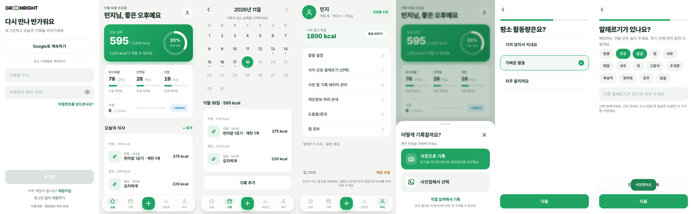
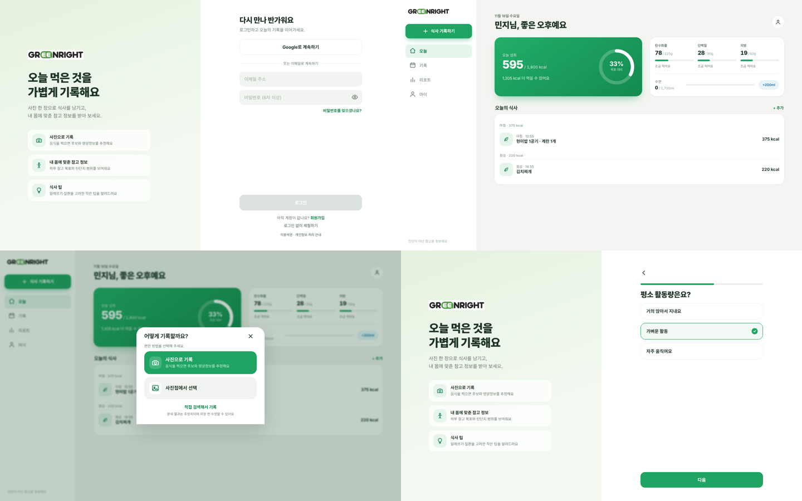

# GreenLight

오늘 먹은 것을 가볍게 기록하는 식단 기록 웹앱이에요.
사진으로 식사를 기록하고, 내 몸에 맞춘 하루 참고 목표와 탄단지 정보를 확인할 수 있어요.




## 주요 기능

- 사진으로 식사 기록 (앱 안 카메라 · 사진첩 선택)
- AI 음식 분석 (Google Gemini API 키 필요, 키가 없으면 시연 모드)
- 직접 검색해서 기록
- 오늘 섭취량 · 탄단지 · 수분 대시보드
- 달력 기록, 주간 식습관 리포트
- 알레르기 · 질환 정보를 반영한 주의 안내
- 모바일 우선 디자인, PC에서는 사이드바가 있는 반응형 레이아웃

## 파일 구성

```
.
├── index.html      # 앱 전체 (HTML · CSS · JS 한 파일)
├── docs/           # README 미리보기 이미지
├── .nojekyll       # GitHub Pages가 파일을 그대로 올리도록 설정
├── .gitignore
└── README.md
```

빌드 과정이 없어요. `index.html` 하나로 바로 실행돼요.

## GitHub Pages로 배포하기

### 방법 1. 웹에서 업로드 (Git 몰라도 됨)

1. GitHub에서 **New repository**를 만들어요. 예: `greenlight`, **Public** 선택
2. 만든 저장소에서 **Add file → Upload files**를 눌러요.
3. 이 폴더 안의 파일을 모두 끌어다 놓고 **Commit changes**를 눌러요.
   - `.nojekyll`처럼 점(.)으로 시작하는 파일은 탐색기에서 안 보일 수 있어요. 빠져도 앱은 동작해요.
4. 저장소의 **Settings → Pages**로 가서
   - Source: **Deploy from a branch**
   - Branch: **main**, 폴더: **/(root)** → **Save**
5. 1~2분 뒤 `https://<내아이디>.github.io/greenlight/` 주소가 생겨요.

### 방법 2. Git 명령어

```bash
cd greenlight
git init
git add .
git commit -m "GreenLight 첫 배포"
git branch -M main
git remote add origin https://github.com/<내아이디>/greenlight.git
git push -u origin main
```

그다음 방법 1의 4~5단계처럼 **Settings → Pages**를 켜요.

## 휴대폰에서 쓰기

- 배포된 `https://` 주소를 휴대폰 **Chrome**(안드로이드)이나 **Safari**(아이폰)로 열어요.
- 카메라는 HTTPS 주소에서만 켜져요. 파일을 직접 열거나 카카오톡 미리보기로 열면 실행되지 않아요.
- 브라우저 메뉴의 **홈 화면에 추가**를 누르면 앱처럼 쓸 수 있어요.

## AI 분석 키

- 앱 안 **마이 → 사진 및 기록 데이터 관리 → AI 분석 키 설정**에서 Gemini API 키를 넣어요.
- 키는 사용자 기기(브라우저 저장소)에만 저장돼요.
- ⚠️ `index.html` 안의 `GEMINI_KEY_DEFAULT`에 키를 직접 적어서 올리지 마세요. 공개 저장소에 올리면 누구나 볼 수 있어요.

## 데이터 저장

계정, 프로필, 식사 기록은 모두 사용하는 기기의 브라우저 저장소(localStorage)에만 저장돼요. 서버가 없어서 다른 기기와는 동기화되지 않아요.

## 안내

앱이 보여주는 영양 정보와 조언은 추정치예요. 진단이나 치료를 대신하지 않아요.
